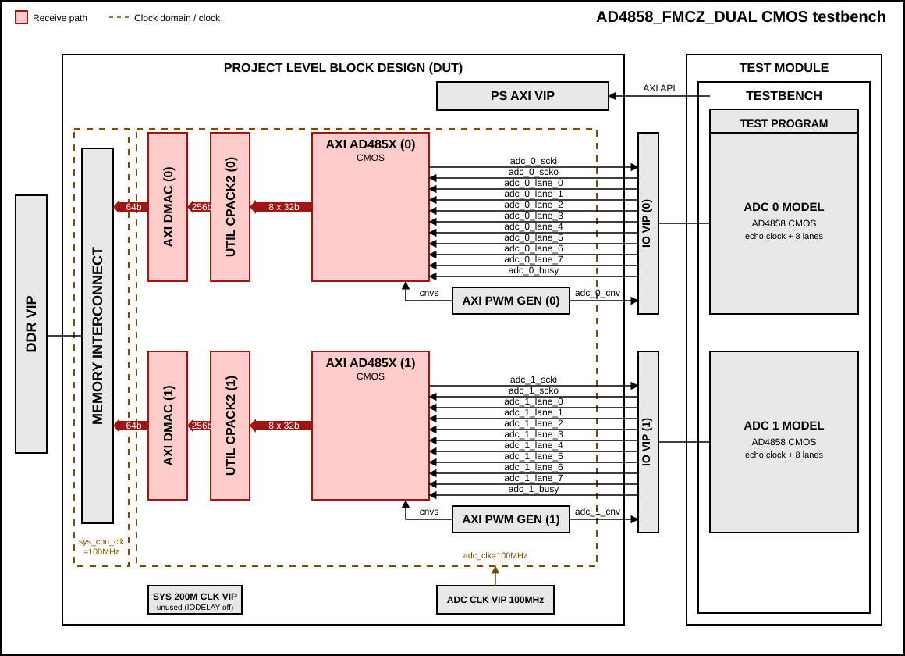
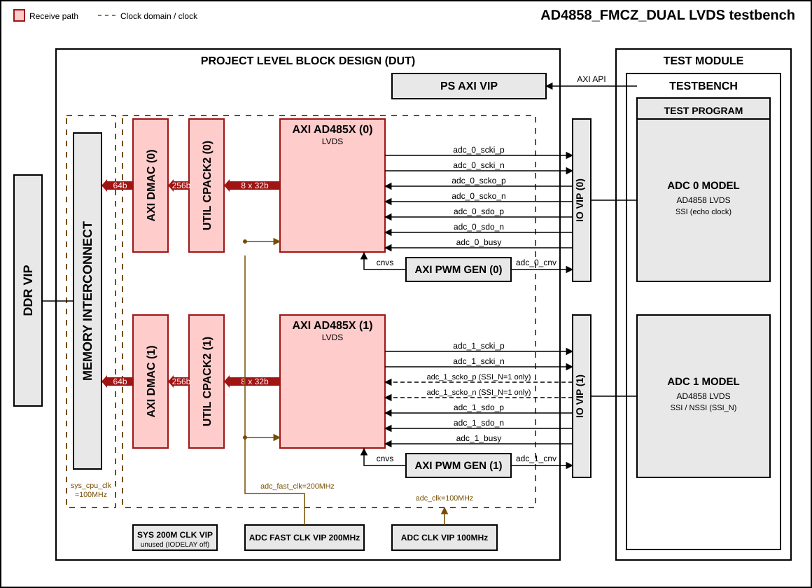

.. _ad4858_fmcz_dual:

AD4858_FMCZ_DUAL
===============================================================================

Overview
-------------------------------------------------------------------------------

The purpose of this testbench is to validate the data interfaces functionality
of the :git-hdl:`projects/ad4858_fmcz_dual` reference design.

The reference design uses two AD4858 devices (20-bit, 8 channels,
simultaneous sampling), each connected to its own ``axi_ad485x`` core, DMA
and PWM generator. The testbench supports both CMOS and LVDS interface modes.

The two ADC instances are verified in parallel: both are triggered and read out
at the same time, their data is transferred to DDR through two DMA channels
and then checked against the expected values.

The main differences compared to the :ref:`single device testbench <ad485x>`
are:

-  Two independent ADC, DMA and PWM generator instances, each with its own
   base address and its own set of signals (``_0_`` and ``_1_``).
-  For the LVDS interface, ADC 0 always uses the echo clock (SCKO). ADC 1 either
   uses the echo clock too (source synchronous, ``SSI_N = 1``) or has no echo
   clock and uses the non-source-synchronous (NSSI) capture path
   (``SSI_N = 0``).
-  The ADC clocks come from clock VIPs instead of the ``axi_clkgen`` MMCM.

Block design
-------------------------------------------------------------------------------

The testbench block design includes part of the AD4858_FMCZ_DUAL HDL reference
design, along with VIPs used for clocking, reset, PS and DDR simulations.

Block diagram
~~~~~~~~~~~~~~~~~~~~~~~~~~~~~~~~~~~~~~~~~~~~~~~~~~~~~~~~~~~~~~~~~~~~~~~~~~~~~~~

The data path and clock domains are depicted in the below diagrams:

AD4858_FMCZ_DUAL CMOS interface
^^^^^^^^^^^^^^^^^^^^^^^^^^^^^^^^^^^^^^^^^^^^^^^^^^^^^^^^^^^^^^^^^^^^^^^^^^^^^^^

.. admonition:: Legend
   :class: note

   - Both ADCs use the echo clock (SCKO) and 8 data lanes, so the ``SSI_N``
     parameter has no effect.
   - The ADC clock comes from a clock VIP (100 MHz) instead of the
     ``axi_clkgen`` MMCM, and the memory path runs on ``sys_cpu_clk``.
   - The IO delay primitives are bypassed, so ``sys_200m_clk`` is not used by
     the interface.

AD4858_FMCZ_DUAL LVDS interface
^^^^^^^^^^^^^^^^^^^^^^^^^^^^^^^^^^^^^^^^^^^^^^^^^^^^^^^^^^^^^^^^^^^^^^^^^^^^^^^

.. admonition:: Legend
   :class: note

   - ADC 0 always uses the echo clock (SCKO).
   - ADC 1 SCKO (dashed) is connected only when ``SSI_N=1``. With ``SSI_N=0``
     (NSSI) ADC 1 has no echo clock and is aligned with the valid/index delay
     taps.
   - The ADC clocks come from clock VIPs (``adc_clk`` 100 MHz and
     ``adc_fast_clk`` 200 MHz, half of the hardware frequencies), and the
     memory path runs on ``sys_cpu_clk``.

Clocking
~~~~~~~~~~~~~~~~~~~~~~~~~~~~~~~~~~~~~~~~~~~~~~~~~~~~~~~~~~~~~~~~~~~~~~~~~~~~~~~

The ADC clocks are generated by clock VIPs, bypassing the MMCM of the
``axi_clkgen`` to avoid a long lock time in simulation:

=================== ============ ==============================================
Clock               Frequency    Usage
=================== ============ ==============================================
``sys_200m_clk``    200 MHz      Reference clock of the ``axi_clkgen``
``adc_clk``         100 MHz      ADC core clock, DMA FIFO write clock, PWM
``adc_fast_clk``    200 MHz      LVDS only: serializer/deserializer clock
=================== ============ ==============================================

.. note::

   The clock VIP can only generate periods that are a whole number of
   nanoseconds. A 400 MHz clock (2.5 ns) would be rounded to 3 ns, which breaks
   the 4:1 DDR serialization of the LVDS interface. For this reason the
   simulation runs the ADC clocks at half of the hardware frequencies
   (100/200 MHz instead of 200/400 MHz). The ratio between ``adc_fast_clk`` and
   ``adc_clk`` is the same as in hardware (2:1).

The input delay primitives are bypassed in simulation (``IODELAY_ENABLE`` is
set to 0 for both ADC cores), and the memory path (DMA, interconnect, DDR VIP)
runs on a single clock domain.

Configuration parameters and modes
~~~~~~~~~~~~~~~~~~~~~~~~~~~~~~~~~~~~~~~~~~~~~~~~~~~~~~~~~~~~~~~~~~~~~~~~~~~~~~~

The following parameters of this project can be configured:

-  DEVICE: Defines the target device. Only ``AD4858`` is supported (20-bit
   resolution, 8 channels).

-  LVDS_CMOS_N: Defines the physical interface type, same as in the HDL
   project. Options: 0 - CMOS, 1 - LVDS

-  SSI_N: Defines the synchronization of the second ADC in LVDS mode (ADC 0 is
   always source synchronous). Not used in CMOS mode.
   Options: 0 - ADC 1 is non-source-synchronous (NSSI, no echo clock),
   1 - ADC 1 is source synchronous (SSI, uses the echo clock). The HDL project
   defaults to 0.

The following parameters of the HDL project are overridden by the testbench
for both ``axi_ad485x`` instances:

-  IODELAY_CTRL = 0: the IDELAYCTRL is not instantiated.
-  IODELAY_ENABLE = 0: the IDELAYE3 primitives are bypassed.

Configuration files
^^^^^^^^^^^^^^^^^^^^^^^^^^^^^^^^^^^^^^^^^^^^^^^^^^^^^^^^^^^^^^^^^^^^^^^^^^^^^^^^

The following configuration files are available:

+---------------------+---------------------------------------------+
| Configuration       | Parameters                                  |
| mode                +----------+----------------+-----------------+
|                     | DEVICE   | LVDS_CMOS_N    | SSI_N           |
+=====================+==========+================+=================+
| cfg_cmos_rand       | AD4858   | 0 (CMOS)       | 0 (not used)    |
+---------------------+----------+----------------+-----------------+
| cfg_lvds_ssi_rand   | AD4858   | 1 (LVDS)       | 1 (ADC 1 SSI)   |
+---------------------+----------+----------------+-----------------+
| cfg_lvds_nssi_rand  | AD4858   | 1 (LVDS)       | 0 (ADC 1 NSSI)  |
+---------------------+----------+----------------+-----------------+

Tests
^^^^^^^^^^^^^^^^^^^^^^^^^^^^^^^^^^^^^^^^^^^^^^^^^^^^^^^^^^^^^^^^^^^^^^^^^^^^^^^^

The following test program files are available:

================== =================================================
Test program       Usage
================== =================================================
test_program_cmos  Tests the CMOS interface
test_program_lvds  Tests the LVDS interface (SSI and NSSI, selected
                   by the ``SSI_N`` parameter of the configuration)
================== =================================================

Available configurations & tests combinations
^^^^^^^^^^^^^^^^^^^^^^^^^^^^^^^^^^^^^^^^^^^^^^^^^^^^^^^^^^^^^^^^^^^^^^^^^^^^^^^^

The test programs must match the interface type of the configuration. The two
LVDS configurations use the same test program, which adapts the ADC 1 model to
the ``SSI_N`` value of the configuration:

-  ``SSI_N = 1``: ADC 1 is modeled like ADC 0, with the echo clock (SCKO)
   following the input clock.
-  ``SSI_N = 0``: ADC 1 has no echo clock. The most significant bit is placed
   on SDO before the first clock edge and SDO is delayed by half of the bit
   period, so that it is stable when sampled.

================== ================== ==================================================
Configuration      Test               Build command
================== ================== ==================================================
cfg_cmos_rand      test_program_cmos  make CFG=cfg_cmos_rand TST=test_program_cmos
cfg_lvds_ssi_rand  test_program_lvds  make CFG=cfg_lvds_ssi_rand TST=test_program_lvds
cfg_lvds_nssi_rand test_program_lvds  make CFG=cfg_lvds_nssi_rand TST=test_program_lvds
================== ================== ==================================================

.. error::

    Mixing a wrong pair of CFG and TST (e.g., CMOS config with LVDS test) will
    result in a simulation error. Please use the matching interface type.

CPU/Memory interconnect addresses
~~~~~~~~~~~~~~~~~~~~~~~~~~~~~~~~~~~~~~~~~~~~~~~~~~~~~~~~~~~~~~~~~~~~~~~~~~~~~~~

Below are the CPU/Memory interconnect addresses used in this project:

==============  ===========
Instance        Address
==============  ===========
axi_ad4858_0    0x43C0_0000
axi_pwm_gen_0   0x43D0_0000
ad4858_dma_0    0x43E0_0000
adc_clkgen      0x4400_0000
axi_ad4858_1    0x44C0_0000
axi_pwm_gen_1   0x44D0_0000
ad4858_dma_1    0x44E0_0000
ddr_axi_vip     0x8000_0000
==============  ===========

Interrupts
~~~~~~~~~~~~~~~~~~~~~~~~~~~~~~~~~~~~~~~~~~~~~~~~~~~~~~~~~~~~~~~~~~~~~~~~~~~~~~~

Below are the Programmable Logic interrupts used in this project:

===============  ===
Instance name    HDL
===============  ===
ad4858_dma_0     10
ad4858_dma_1     11
===============  ===

Test stimulus
-------------------------------------------------------------------------------

Test parameters
~~~~~~~~~~~~~~~~~~~~~~~~~~~~~~~~~~~~~~~~~~~~~~~~~~~~~~~~~~~~~~~~~~~~~~~~~~~~~~~

The following test parameters are available:

-  packet_format: Defines the packet format mode.
   Options: 0, 1, 2, 3

   +---------------+--------------+
   | packet_format | AD4858       |
   |               | (20-bit)     |
   +===============+==============+
   | 0             | 20 bits      |
   +---------------+--------------+
   | 1             | 24 bits      |
   +---------------+--------------+
   | 2/3           | 32 bits      |
   +---------------+--------------+

-  crc_en: Enables CRC checking.
   Options: 0 - Disabled, 1 - Enabled

-  os_en: Enables oversampling mode.
   Options: 0 - Disabled, 1 - Enabled

The test programs internally generate all valid combinations of
``packet_format``, ``crc_en`` and ``os_en``, then randomly select a few test
cases to run: 2 to 3 cases for LVDS and 2 cases for CMOS. The same settings are
applied to both ADC instances. Each test case captures 16 conversions (LVDS) or
10 conversions (CMOS) on every channel of both devices.

.. note::

   The combination of CRC and oversampling is not supported and is excluded
   from the generated test cases: the start of the transfer is triggered by
   every oversampling sub-conversion, which resets the channel index tracking
   before the CRC packet can be captured.

.. note::

   The conversion period of the PWM generators is chosen so that the longest
   readout (9 words of 32 bits, with CRC) completes before the next
   conversion starts. If the readout does not fit, the test program prints
   ``Data transaction doesn't meet minimum timing requirement!``.

Test programs
~~~~~~~~~~~~~~~~~~~~~~~~~~~~~~~~~~~~~~~~~~~~~~~~~~~~~~~~~~~~~~~~~~~~~~~~~~~~~~~

Both CMOS and LVDS test programs share the same structure, consisting of the
following tests:

Environment bringup
^^^^^^^^^^^^^^^^^^^^^^^^^^^^^^^^^^^^^^^^^^^^^^^^^^^^^^^^^^^^^^^^^^^^^^^^^^^^^^^

The steps of the environment bringup are:

* Create the environment
* Start the environment
* Start the clocks
* Assert the resets

Sanity test
^^^^^^^^^^^^^^^^^^^^^^^^^^^^^^^^^^^^^^^^^^^^^^^^^^^^^^^^^^^^^^^^^^^^^^^^^^^^^^^

This test is used to check the communication with the AXI interfaces by:

* Testing the sanity of both DMAs (read/write SCRATCH register)
* Testing the sanity of both PWM generators

Data acquisition test
^^^^^^^^^^^^^^^^^^^^^^^^^^^^^^^^^^^^^^^^^^^^^^^^^^^^^^^^^^^^^^^^^^^^^^^^^^^^^^^

For each selected test case, the following steps are executed on both ADC
instances:

* Reset and enable the ADC cores
* Configure the packet format and oversampling mode
* Enable CRC checking
* Configure the number of active lanes
* For LVDS with ``SSI_N = 0``, configure the NSSI valid/index delay taps of ADC 1
* Enable ADC channels
* Prepare the expected test data
* Configure the clock generator (axi_clkgen)
* Configure both DMAs for data reception (separate destination addresses in
  DDR)
* Configure and start both PWM generators for conversion triggering
* Wait for both DMA transfers to complete (in parallel)
* Verify the data captured in DDR from each ADC against the expected values
* Perform CRC verification on each channel
* Reset the ADC models before the next test case

Stop the environment
^^^^^^^^^^^^^^^^^^^^^^^^^^^^^^^^^^^^^^^^^^^^^^^^^^^^^^^^^^^^^^^^^^^^^^^^^^^^^^^

* Stop the environment

Building the testbench
-------------------------------------------------------------------------------

The testbench is built upon ADI's generic HDL reference design framework.
ADI does not distribute compiled files of these projects so they must be built
from the sources available :git-hdl:`here </>` and :git-testbenches:`here </>`,
with the specified hierarchy described :ref:`build_tb set_up_tb_repo`.
To get the source you must
`clone <https://git-scm.com/book/en/v2/Git-Basics-Getting-a-Git-Repository>`__
the HDL repository, and then build the project as follows:.

**Linux/Cygwin/WSL**

*Example 1*

Build all the possible combinations of tests and configurations, using only the
command line.

.. shell::
   :showuser:

   $cd testbenches/project/ad4858_fmcz_dual
   $make

*Example 2*

Build all the possible combinations of tests and configurations, using the
Vivado GUI. This command will launch Vivado, will run the simulation and display
the waveforms.

.. shell::
   :showuser:

   $cd testbenches/project/ad4858_fmcz_dual
   $make MODE=gui

*Example 3*

Build a particular combination of test and configuration, using the Vivado GUI.
This command will launch Vivado, will run the simulation and display the
waveforms.

.. shell::
   :showuser:

   $cd testbenches/project/ad4858_fmcz_dual
   $make CFG=cfg_cmos_rand TST=test_program_cmos MODE=gui

*Example 4*

Build the LVDS interface tests, with ADC 1 source synchronous (SSI) or
non-source-synchronous (NSSI):

.. shell::
   :showuser:

   $cd testbenches/project/ad4858_fmcz_dual
   $make CFG=cfg_lvds_ssi_rand TST=test_program_lvds MODE=gui
   $make CFG=cfg_lvds_nssi_rand TST=test_program_lvds MODE=gui

.. note::

   Do not run two simulations of the same configuration at the same time (for
   example a GUI session and a batch run), as they share the same ``runs``
   folder.

In GUI mode, the waveform configuration of each test is loaded from
``waves/<configuration name>.wcfg``. It shows the clocks, the ADC interface
signals, the ``axi_ad485x`` outputs, the pack and DMA signals and the expected
versus captured data for both ADCs.

The built projects can be found in the ``runs`` folder, where each configuration
specific build has it's own folder named after the configuration file's name.
Example: if the following command was run for a single configuration in the
clean folder (no runs folder available):

``make CFG=cfg_lvds_nssi_rand``

Then the subfolder under ``runs`` name will be:

``cfg_lvds_nssi_rand``

Resources
-------------------------------------------------------------------------------

HDL related dependencies forming the DUT
~~~~~~~~~~~~~~~~~~~~~~~~~~~~~~~~~~~~~~~~~~~~~~~~~~~~~~~~~~~~~~~~~~~~~~~~~~~~~~~

.. list-table::
   :widths: 30 45 25
   :header-rows: 1

   * - IP name
     - Source code link
     - Documentation link
   * - AXI_AD485X
     - :git-hdl:`library/axi_ad485x`
     - :external+hdl:ref:`axi_ad485x`
   * - AXI_CLKGEN
     - :git-hdl:`library/axi_clkgen`
     - :external+hdl:ref:`axi_clkgen`
   * - AXI_DMAC
     - :git-hdl:`library/axi_dmac`
     - :external+hdl:ref:`axi_dmac`
   * - AXI_PWM_GEN
     - :git-hdl:`library/axi_pwm_gen`
     - :external+hdl:ref:`axi_pwm_gen`
   * - UTIL_CPACK2
     - :git-hdl:`library/util_pack/util_cpack2`
     - :external+hdl:ref:`util_cpack2`

Testbenches related dependencies
~~~~~~~~~~~~~~~~~~~~~~~~~~~~~~~~~~~~~~~~~~~~~~~~~~~~~~~~~~~~~~~~~~~~~~~~~~~~~~~

.. include:: ../../common/dependency_common.rst

Testbench specific dependencies:

.. list-table::
   :widths: 30 45 25
   :header-rows: 1

   * - SV dependency name
     - Source code link
     - Documentation link
   * - ADI_REGMAP_ADC_PKG
     - :git-testbenches:`library/regmaps/adi_regmap_adc_pkg.sv`
     - ---
   * - ADI_REGMAP_CLKGEN_PKG
     - :git-testbenches:`library/regmaps/adi_regmap_clkgen_pkg.sv`
     - ---
   * - ADI_REGMAP_COMMON_PKG
     - :git-testbenches:`library/regmaps/adi_regmap_common_pkg.sv`
     - ---
   * - ADI_REGMAP_DMAC_PKG
     - :git-testbenches:`library/regmaps/adi_regmap_dmac_pkg.sv`
     - ---
   * - ADI_REGMAP_PKG
     - :git-testbenches:`library/regmaps/adi_regmap_pkg.sv`
     - ---
   * - ADI_REGMAP_PWM_GEN_PKG
     - :git-testbenches:`library/regmaps/adi_regmap_pwm_gen_pkg.sv`
     - ---
   * - ADC_API
     - :git-testbenches:`library/drivers/adc_api_pkg.sv`
     - ---
   * - CLK_GEN_API
     - :git-testbenches:`library/drivers/clk_gen_api_pkg.sv`
     - ---
   * - COMMON_API
     - :git-testbenches:`library/drivers/common_api_pkg.sv`
     - ---
   * - DMA_TRANS
     - :git-testbenches:`library/drivers/dmac/dma_trans.sv`
     - ---
   * - DMAC_API
     - :git-testbenches:`library/drivers/dmac/dmac_api.sv`
     - ---
   * - PWM_GEN_API
     - :git-testbenches:`library/drivers/pwm_gen_api_pkg.sv`
     - ---

.. include:: ../../../common/more_information.rst

.. include:: ../../../common/support.rst
