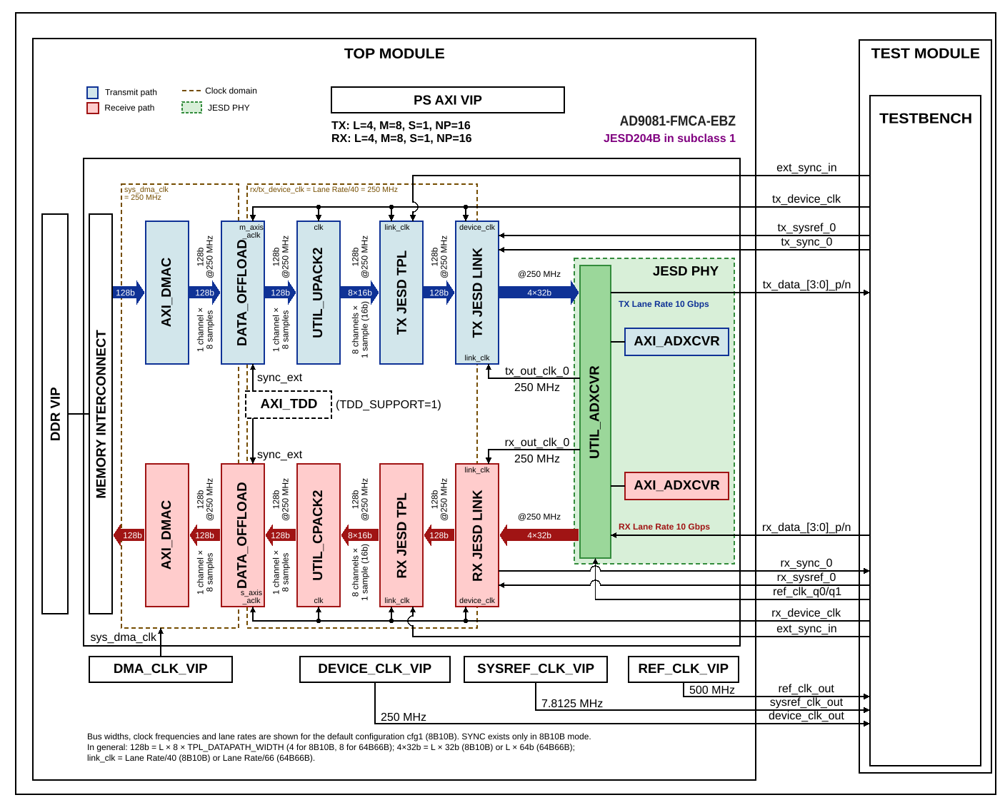

.. _mxfe:

MxFE
================================================================================

Overview
-------------------------------------------------------------------------------

The purpose of this testbench is to validate the JESD204B/C serial interface
functionality of the :git-hdl:`projects/ad9081_fmca_ebz` reference design,
commonly referred to as the MxFE platform.

The entire HDL documentation can be found here
:external+hdl:ref:`AD9081-FMCA-EBZ HDL project <ad9081_fmca_ebz>`.

Block design
-------------------------------------------------------------------------------

The testbench block design includes part of the AD9081-FMCA-EBZ HDL reference
design, along with VIPs used for clocking, reset, PS and DDR simulations.
The TX data path is looped back to the RX data path at the serial lane level,
allowing full TX-to-RX data integrity verification without an external device
model.

Block diagram
~~~~~~~~~~~~~~~~~~~~~~~~~~~~~~~~~~~~~~~~~~~~~~~~~~~~~~~~~~~~~~~~~~~~~~~~~~~~~~~

The data path and clock domains are depicted in the below diagram:

.. collapsible:: Click here for details on the block diagram modules

   .. list-table::
      :widths: 10 20 35 35
      :header-rows: 1

      * - Block name
        - IP name
        - Documentation
        - Additional info
      * - AXI_DMAC
        - :git-hdl:`axi_dmac <library/axi_dmac>`
        - :external+hdl:ref:`axi_dmac`
        - 2 instances, ``axi_mxfe_tx_dma`` for TX and ``axi_mxfe_rx_dma`` for RX
      * - DATA_OFFLOAD
        - :git-hdl:`data_offload <library/data_offload>`
        - :external+hdl:ref:`data_offload`
        - 2 instances, ``mxfe_tx_data_offload`` for TX and ``mxfe_rx_data_offload`` for RX
      * - UTIL_UPACK2
        - :git-hdl:`util_upack2 <library/util_pack/util_upack2>`
        - :external+hdl:ref:`util_upack2`
        - ``util_mxfe_upack``
      * - UTIL_CPACK2
        - :git-hdl:`util_cpack2 <library/util_pack/util_cpack2>`
        - :external+hdl:ref:`util_cpack2`
        - ``util_mxfe_cpack``
      * - TX JESD TPL
        - :git-hdl:`ad_ip_jesd204_tpl_dac <library/jesd204/ad_ip_jesd204_tpl_dac>`
        - :external+hdl:ref:`ad_ip_jesd204_tpl_dac`
        - ``tx_mxfe_tpl_core``, instantiated by the ``adi_tpl_jesd204_tx_create`` procedure
      * - RX JESD TPL
        - :git-hdl:`ad_ip_jesd204_tpl_adc <library/jesd204/ad_ip_jesd204_tpl_adc>`
        - :external+hdl:ref:`ad_ip_jesd204_tpl_adc`
        - ``rx_mxfe_tpl_core``, instantiated by the ``adi_tpl_jesd204_rx_create`` procedure
      * - TX JESD LINK
        - :git-hdl:`axi_jesd204_tx <library/jesd204/axi_jesd204_tx>`
        - :external+hdl:ref:`axi_jesd204_tx`
        - ``axi_mxfe_tx_jesd``, instantiated by the ``adi_axi_jesd204_tx_create`` procedure
      * - RX JESD LINK
        - :git-hdl:`axi_jesd204_rx <library/jesd204/axi_jesd204_rx>`
        - :external+hdl:ref:`axi_jesd204_rx`
        - ``axi_mxfe_rx_jesd``, instantiated by the ``adi_axi_jesd204_rx_create`` procedure
      * - AXI_ADXCVR
        - :git-hdl:`axi_adxcvr <library/xilinx/axi_adxcvr>`
        - :external+hdl:ref:`axi_adxcvr amd`
        - 2 instances, ``axi_mxfe_tx_xcvr`` for TX and ``axi_mxfe_rx_xcvr`` for RX
      * - UTIL_ADXCVR
        - :git-hdl:`util_adxcvr <library/xilinx/util_adxcvr>`
        - :external+hdl:ref:`util_adxcvr`
        - ``util_mxfe_xcvr``, shared between the TX and RX paths
      * - AXI_TDD
        - :git-hdl:`axi_tdd <library/axi_tdd>`
        - :external+hdl:ref:`axi_tdd`
        - ``axi_tdd_0``, instantiated only when ``TDD_SUPPORT=1``; drives ``sync_ext`` of both data offloads
      * - MEMORY INTERCONNECT
        - ``axi_mem_interconnect``
        - ---
        - Part of the test harness (AXI SmartConnect); connects both AXI_DMAC, the RX AXI_ADXCVR (EyeScan)
          and the PS AXI VIP to the DDR VIP

Configuration parameters and modes
~~~~~~~~~~~~~~~~~~~~~~~~~~~~~~~~~~~~~~~~~~~~~~~~~~~~~~~~~~~~~~~~~~~~~~~~~~~~~~~

The following parameters of this testbench can be configured:

-  JESD_MODE: the JESD204 encoding mode (8B10B or 64B66B)
-  REF_CLK_RATE: the rate of the reference clock in MHz
-  LANE_RATE: the JESD204 lane rate in Gbps
-  PLL_TYPE: the transceiver PLL type (QPLL0 or QPLL1)
-  [RX/TX]_LANE_RATE: per-direction lane rate in Gbps
-  [RX/TX]_PLL_SEL: transceiver PLL selection (2 = QPLL1); set in some
   configuration files, but not used by the AD9081 block design
-  [RX/TX]_NUM_LINKS: number of JESD204 links
-  [RX/TX]_JESD_M: number of converters per link
-  [RX/TX]_JESD_L: number of lanes per link
-  [RX/TX]_JESD_S: number of samples per frame
-  [RX/TX]_JESD_NP: number of bits per sample
-  [RX/TX]_JESD_F: number of octets per frame per lane
-  [RX/TX]_JESD_K: number of frames per multiframe
-  TDD_SUPPORT: enables TDD (Time Division Duplex) engine integration
-  SHARED_DEVCLK: enables shared device clock between RX and TX paths
-  TDD_CHANNEL_CNT: number of TDD channels
-  TDD_SYNC_WIDTH: TDD sync signal width
-  TDD_SYNC_INT: TDD internal sync enable
-  TDD_SYNC_EXT: TDD external sync enable
-  TDD_SYNC_EXT_CDC: TDD external sync CDC enable

Configuration files
^^^^^^^^^^^^^^^^^^^^^^^^^^^^^^^^^^^^^^^^^^^^^^^^^^^^^^^^^^^^^^^^^^^^^^^^^^^^^^^^

The following configuration files are available:

.. list-table::
   :header-rows: 1

   * - Parameter
     - cfg1
     - cfg2_64b66b_np8
     - cfg3_64b66b_np12
     - cfg4_8b10b_np12
     - cfg5_204c_txmode_10_rxmode_11
     - cfg6_m16_l8_tdd
   * - JESD_MODE
     - 8B10B
     - 64B66B
     - 64B66B
     - 8B10B
     - 64B66B
     - 8B10B
   * - REF_CLK_RATE
     - 500
     - 500
     - 250
     - 500
     - 500
     - 500
   * - LANE_RATE
     - 10
     - 16.5
     - 16.5
     - 10
     - 16.5
     - 10
   * - PLL_TYPE
     - QPLL0
     - QPLL1
     - QPLL1
     - QPLL0
     - QPLL1
     - QPLL0
   * - RX_LANE_RATE
     - 10
     - 16.5
     - 16.5
     - 10
     - 16.5
     - 10
   * - RX_PLL_SEL
     - ---
     - 2
     - 2
     - 2
     - 2
     - ---
   * - TX_LANE_RATE
     - 10
     - 16.5
     - 16.5
     - 10
     - 16.5
     - 10
   * - TX_PLL_SEL
     - ---
     - 2
     - 2
     - 2
     - 2
     - ---
   * - RX_NUM_LINKS
     - 1
     - 1
     - 1
     - 1
     - 1
     - 1
   * - RX_JESD_M
     - 8
     - 2
     - 4
     - 8
     - 4
     - 16
   * - RX_JESD_L
     - 4
     - 8
     - 4
     - 2
     - 4
     - 8
   * - RX_JESD_S
     - 1
     - 4
     - 2
     - 1
     - 1
     - 1
   * - RX_JESD_NP
     - 16
     - 8
     - 12
     - 12
     - 16
     - 16
   * - RX_JESD_F
     - 4
     - 1
     - 3
     - 6
     - 2
     - 4
   * - RX_JESD_K
     - 32
     - 256
     - 256
     - 32
     - 128
     - 32
   * - TX_NUM_LINKS
     - 1
     - 1
     - 1
     - 1
     - 1
     - 1
   * - TX_JESD_M
     - 8
     - 2
     - 4
     - 8
     - 4
     - 16
   * - TX_JESD_L
     - 4
     - 8
     - 4
     - 2
     - 4
     - 8
   * - TX_JESD_S
     - 1
     - 4
     - 2
     - 1
     - 1
     - 1
   * - TX_JESD_NP
     - 16
     - 8
     - 12
     - 12
     - 16
     - 16
   * - TX_JESD_F
     - 4
     - 1
     - 3
     - 6
     - 2
     - 4
   * - TX_JESD_K
     - 32
     - 256
     - 256
     - 32
     - 128
     - 32
   * - TDD_SUPPORT
     - 0
     - 0
     - 0
     - 0
     - 0
     - 1
   * - SHARED_DEVCLK
     - ---
     - ---
     - ---
     - ---
     - ---
     - 1
   * - TDD_CHANNEL_CNT
     - ---
     - ---
     - ---
     - ---
     - ---
     - 2
   * - TDD_SYNC_WIDTH
     - ---
     - ---
     - ---
     - ---
     - ---
     - 32
   * - TDD_SYNC_INT
     - ---
     - ---
     - ---
     - ---
     - ---
     - 1
   * - TDD_SYNC_EXT
     - ---
     - ---
     - ---
     - ---
     - ---
     - 0
   * - TDD_SYNC_EXT_CDC
     - ---
     - ---
     - ---
     - ---
     - ---
     - 0

Tests
^^^^^^^^^^^^^^^^^^^^^^^^^^^^^^^^^^^^^^^^^^^^^^^^^^^^^^^^^^^^^^^^^^^^^^^^^^^^^^^^

The following test program file is available:

============ ==========================================
Test program Usage
============ ==========================================
test_program Tests the MxFE JESD204 project data paths.
============ ==========================================

Available configurations & tests combinations
^^^^^^^^^^^^^^^^^^^^^^^^^^^^^^^^^^^^^^^^^^^^^^^^^^^^^^^^^^^^^^^^^^^^^^^^^^^^^^^^

The test program is compatible with all of the above mentioned configurations.

CPU/Memory interconnect addresses
~~~~~~~~~~~~~~~~~~~~~~~~~~~~~~~~~~~~~~~~~~~~~~~~~~~~~~~~~~~~~~~~~~~~~~~~~~~~~~~

Below are the CPU/Memory interconnect addresses used in this project:

=====================  ===========
Instance               Address
=====================  ===========
axi_intc               0x4120_0000
adc_tpl                0x44A1_0000
rx_xcvr                0x44A6_0000
axi_jesd_rx            0x44A9_0000
dac_tpl                0x44B1_0000
tx_xcvr                0x44B6_0000
axi_jesd_tx            0x44B9_0000
rx_dma                 0x7C42_0000
tx_dma                 0x7C43_0000
tx_data_offload        0x7C44_0000
rx_data_offload        0x7C45_0000
axi_tdd *              0x7C46_0000
ddr_axi_vip            0x8000_0000
=====================  ===========

.. admonition:: Legend
   :class: note

   - ``*`` instantiated only when TDD_SUPPORT=1

Interrupts
~~~~~~~~~~~~~~~~~~~~~~~~~~~~~~~~~~~~~~~~~~~~~~~~~~~~~~~~~~~~~~~~~~~~~~~~~~~~~~~

Below are the Programmable Logic interrupts used in this project:

===============  ===
Instance name    HDL
===============  ===
rx_dma            12
tx_dma            13
axi_jesd_rx       14
axi_jesd_tx       15
===============  ===

Test stimulus
-------------------------------------------------------------------------------

The test program is structured into several tests as follows:

Environment bringup
~~~~~~~~~~~~~~~~~~~~~~~~~~~~~~~~~~~~~~~~~~~~~~~~~~~~~~~~~~~~~~~~~~~~~~~~~~~~~~~

The steps of the environment bringup are:

* Create the environment
* Start the environment
* Assert the resets

JESD link object initialization and transceiver setup
~~~~~~~~~~~~~~~~~~~~~~~~~~~~~~~~~~~~~~~~~~~~~~~~~~~~~~~~~~~~~~~~~~~~~~~~~~~~~~~

* Create and configure a JESD204 link object based on the RX configuration
  parameters (L, M, F, S, K, NP) and the encoding mode (8B10B or 64B66B).
* Instantiate RX and TX link-layer objects and connect them to the AXI master
  sequencer with their respective base addresses.
* Instantiate RX and TX transceiver objects.
* Call ``probe()`` on each to verify initial register states.

Clock frequency configuration
~~~~~~~~~~~~~~~~~~~~~~~~~~~~~~~~~~~~~~~~~~~~~~~~~~~~~~~~~~~~~~~~~~~~~~~~~~~~~~~

* Set the reference clock (``REF_CLK``) frequency based on the configured
  ``REF_CLK_RATE``.
* Compute the device clock and SYSREF clock from the link-layer object using
  ``calc_device_clk()`` and ``calc_sysref_clk()``.
* Apply the calculated frequencies to the corresponding clock VIP interfaces
  (``DEVICE_CLK``, ``SYSREF_CLK``, ``DMA_CLK``).
* Start all clocks and configure transceiver clocks for both RX and TX using
  ``setup_clocks()`` with the lane rate and reference clock.

JESD link test (DDS)
~~~~~~~~~~~~~~~~~~~~~~~~~~~~~~~~~~~~~~~~~~~~~~~~~~~~~~~~~~~~~~~~~~~~~~~~~~~~~~~

Tests the JESD204 data path using DDS-generated tones:

* **TX PHY initialization** — bring up the TX transceiver.
* **DAC TPL configuration** — for each TX converter, select DDS as the data
  source and configure tone amplitude (``DDS_SCALE_1``) and frequency increment
  (``DDS_INCR_1``).
* **Release DAC reset** — deassert ``RSTN`` on the DAC common block.
* **Synchronize DDS cores** — trigger DDS synchronization via the DAC common
  control register.
* **Configure data offload** — set the RX offload to one-shot mode and the TX
  offload to normal (non-bypass) mode, without hardware sync.
* **Bring up TX link** — start the TX link layer.
* **RX PHY initialization** — bring up the RX transceiver.
* **ADC TPL configuration** — enable all RX converter channels.
* **Release ADC reset** — deassert ``RSTN`` on the ADC common block.
* **Bring up RX link** — start the RX link layer.
* **Wait for link-up** — wait for both TX and RX link layers to report
  link-up status.
* **Simulation delay** — wait 5 us for data flow and link stabilization.
* **Link shutdown** — bring down both links and transceivers.

JESD link test (DMA)
~~~~~~~~~~~~~~~~~~~~~~~~~~~~~~~~~~~~~~~~~~~~~~~~~~~~~~~~~~~~~~~~~~~~~~~~~~~~~~~

Tests the JESD204 data path using DMA-based stimulus:

* **TX PHY initialization** — bring up the TX transceiver.
* **DAC TPL configuration** — for each TX converter, select DMA as the data
  source.
* **Release DAC reset** — deassert ``RSTN`` on the DAC common block.
* **Configure data offload** — set the RX offload to one-shot mode and the TX
  offload to normal (non-bypass) mode, without hardware sync.
* **Write test data to DDR** — write a deterministic incremental pattern to
  DDR memory via ``BackdoorWrite32``. Handles both 16-bit and 12-bit sample
  packing (based on ``TX_JESD_NP``).
* **Configure TX DMA** — enable the TX DMA engine, set transfer length, source
  address, and submit the transfer.
* **Configure RX DMA** — enable the RX DMA engine, set transfer length,
  destination address, and submit the transfer.
* **Wait for data propagation** — wait 5 us for DMA and offload.
* **Bring up TX link** — start the TX link layer.
* **RX PHY initialization** — bring up the RX transceiver.
* **ADC TPL configuration** — enable all RX converter channels.
* **Release ADC reset** — deassert ``RSTN`` on the ADC common block.
* **Bring up RX link** — start the RX link layer.
* **Wait for link-up** — wait for both links to report link-up status.
* **Simulation delay** — wait 5 us for data flow.
* **Verify captured data** — call ``check_captured_data`` to verify the
  received data in DDR matches the expected incremental pattern.
* **Link shutdown** — bring down both links and transceivers.

JESD link test (DMA — RX/TX bypass)
~~~~~~~~~~~~~~~~~~~~~~~~~~~~~~~~~~~~~~~~~~~~~~~~~~~~~~~~~~~~~~~~~~~~~~~~~~~~~~~

Runs the same DMA-based test as above with the TX data offload set to bypass
mode and the RX data offload set to one-shot and bypass mode. The TX DMA runs in
cyclic mode. This validates the direct DMA-to-JESD data path without offload
buffering.

JESD link test (DMA — data offload — TDD)
~~~~~~~~~~~~~~~~~~~~~~~~~~~~~~~~~~~~~~~~~~~~~~~~~~~~~~~~~~~~~~~~~~~~~~~~~~~~~~~

Runs the DMA-based test with the TDD (Time Division Duplex) engine controlling
the data offloads. The test is run for every configuration, but the TDD engine
(``axi_tdd_0``) is instantiated only when ``TDD_SUPPORT=1`` (``cfg6_m16_l8_tdd``);
for the other configurations the TDD register writes have no target:

* **TX offload** — set to single-shot mode with hardware sync.
* **RX offload** — set to single-shot mode with hardware sync.
* **TDD configuration** — configure the TDD engine:

  - Set frame length to 2048 cycles.
  - Configure channel 0 (TX trigger): ON at cycle 0, OFF at cycle 10.
  - Configure channel 1 (RX trigger): ON at cycle 96, OFF at cycle 106
    (accounts for roundtrip latency of ~96 cycles).
  - Enable both TDD channels.
  - Set the sync counter and enable internal sync.

* The rest of the test follows the standard DMA-based flow. After data
  verification, the TDD engine is disabled.

JESD link test (DDS — external sync)
~~~~~~~~~~~~~~~~~~~~~~~~~~~~~~~~~~~~~~~~~~~~~~~~~~~~~~~~~~~~~~~~~~~~~~~~~~~~~~~

Tests the external synchronization mechanism with DDS-generated tones:

* Bring up the full TX and RX data paths (same as the DDS test).
* **Configure data offload** — set RX offload to one-shot mode with a defined
  transfer length.
* **Arm external sync** — write to DAC and ADC TPL sync control registers and
  verify both report armed status via ``DAC_SYNC_STATUS`` and ``ADC_SYNC``.
* **Trigger external sync** — pulse the ``ext_sync`` signal for one
  ``device_clk`` cycle.
* **Verify sync capture** — confirm that both DAC and ADC TPL blocks have
  captured the sync event (status transitions from armed to triggered). The
  received data is not checked in this test.
* **Link shutdown** — bring down links and transceivers.

JESD link test (DMA — external sync)
~~~~~~~~~~~~~~~~~~~~~~~~~~~~~~~~~~~~~~~~~~~~~~~~~~~~~~~~~~~~~~~~~~~~~~~~~~~~~~~

Tests external synchronization with DMA-based stimulus. Combines the DMA data
path setup with the external sync trigger and verification sequence described
above. Only the sync status is verified; the captured data is not checked.

Stop the environment
~~~~~~~~~~~~~~~~~~~~~~~~~~~~~~~~~~~~~~~~~~~~~~~~~~~~~~~~~~~~~~~~~~~~~~~~~~~~~~~

* Environment Stop
   - The base testbench environment is stopped to end the test.
* Stop All Clocks
   - All clocks started previously (``REF_CLK``, ``DEVICE_CLK``,
     ``SYSREF_CLK``) are stopped to ensure clean shutdown.
* Reporting
   - A final informational message indicates that the test has completed.

Building the testbench
-------------------------------------------------------------------------------

The testbench is built upon ADI's generic HDL reference design framework.
ADI does not distribute compiled files of these projects so they must be built
from the sources available :git-hdl:`here </>` and :git-testbenches:`here </>`,
with the specified hierarchy described :ref:`build_tb set_up_tb_repo`.
To get the source you must
`clone <https://git-scm.com/book/en/v2/Git-Basics-Getting-a-Git-Repository>`__
the HDL repository, and then build the project as follows:

**Linux/Cygwin/WSL**

*Example 1*

Build all the possible combinations of tests and configurations, using only the
command line.

.. shell::
   :showuser:

   $cd testbenches/project/mxfe
   $make

*Example 2*

Build all the possible combinations of tests and configurations, using the
Vivado GUI. This command will launch Vivado, will run the simulation and display
the waveforms.

.. shell::
   :showuser:

   $cd testbenches/project/mxfe
   $make MODE=gui

*Example 3*

Build a particular combination of test and configuration, using the Vivado GUI.
This command will launch Vivado, will run the simulation and display the
waveforms.

.. shell::
   :showuser:

   $cd testbenches/project/mxfe
   $make MODE=gui CFG=cfg1 TST=test_program

The built projects can be found in the ``runs`` folder, where each configuration
specific build has its own folder named after the configuration file's name.
Example: if the following command was run for a single configuration in the
clean folder (no runs folder available):

``make CFG=cfg1``

Then the subfolder under ``runs`` name will be:

``cfg1``

Resources
-------------------------------------------------------------------------------

HDL related dependencies forming the DUT
~~~~~~~~~~~~~~~~~~~~~~~~~~~~~~~~~~~~~~~~~~~~~~~~~~~~~~~~~~~~~~~~~~~~~~~~~~~~~~~

.. list-table::
   :widths: 30 45 25
   :header-rows: 1

   * - IP name
     - Source code link
     - Documentation link
   * - AXI_ADXCVR
     - :git-hdl:`library/xilinx/axi_adxcvr`
     - :external+hdl:ref:`axi_adxcvr amd`
   * - AXI_DMAC
     - :git-hdl:`library/axi_dmac`
     - :external+hdl:ref:`axi_dmac`
   * - AXI_JESD204_RX
     - :git-hdl:`library/jesd204/axi_jesd204_rx`
     - :external+hdl:ref:`axi_jesd204_rx`
   * - AXI_JESD204_TX
     - :git-hdl:`library/jesd204/axi_jesd204_tx`
     - :external+hdl:ref:`axi_jesd204_tx`
   * - AXI_TDD
     - :git-hdl:`library/axi_tdd`
     - :external+hdl:ref:`axi_tdd`
   * - DATA_OFFLOAD
     - :git-hdl:`library/data_offload`
     - :external+hdl:ref:`data_offload`
   * - JESD204_RX
     - :git-hdl:`library/jesd204/jesd204_rx`
     - ---
   * - JESD204_TX
     - :git-hdl:`library/jesd204/jesd204_tx`
     - ---
   * - JESD204_TPL_ADC
     - :git-hdl:`library/jesd204/ad_ip_jesd204_tpl_adc`
     - :external+hdl:ref:`ad_ip_jesd204_tpl_adc`
   * - JESD204_TPL_DAC
     - :git-hdl:`library/jesd204/ad_ip_jesd204_tpl_dac`
     - :external+hdl:ref:`ad_ip_jesd204_tpl_dac`
   * - UTIL_ADXCVR
     - :git-hdl:`library/xilinx/util_adxcvr`
     - :external+hdl:ref:`util_adxcvr`
   * - UTIL_CPACK2
     - :git-hdl:`library/util_pack/util_cpack2`
     - :external+hdl:ref:`util_cpack2`
   * - UTIL_DO_RAM
     - :git-hdl:`library/util_do_ram`
     - :external+hdl:ref:`data_offload`
   * - UTIL_UPACK2
     - :git-hdl:`library/util_pack/util_upack2`
     - :external+hdl:ref:`util_upack2`

Testbenches related dependencies
~~~~~~~~~~~~~~~~~~~~~~~~~~~~~~~~~~~~~~~~~~~~~~~~~~~~~~~~~~~~~~~~~~~~~~~~~~~~~~~

.. include:: ../../common/dependency_common.rst

Testbench specific dependencies:

.. list-table::
   :widths: 30 45 25
   :header-rows: 1

   * - SV dependency name
     - Source code link
     - Documentation link
   * - ADI_JESD204
     - :git-testbenches:`library/drivers/jesd/adi_jesd204_pkg.sv`
     - ---
   * - ADI_XCVR
     - :git-testbenches:`library/drivers/xcvr/adi_xcvr_pkg.sv`
     - ---
   * - DMA_TRANS
     - :git-testbenches:`library/drivers/dmac/dma_trans.sv`
     - ---
   * - DMAC_API
     - :git-testbenches:`library/drivers/dmac/dmac_api.sv`
     - ---
   * - TDD_API
     - :git-testbenches:`library/drivers/tdd_api_pkg.sv`
     - ---
   * - ADI_REGMAP_DMAC_PKG
     - :git-testbenches:`library/regmaps/adi_regmap_dmac_pkg.sv`
     - ---
   * - ADI_REGMAP_PKG
     - :git-testbenches:`library/regmaps/adi_regmap_pkg.sv`
     - ---
   * - ADI_REGMAP_ADC_PKG
     - :git-testbenches:`library/regmaps/adi_regmap_adc_pkg.sv`
     - ---
   * - ADI_REGMAP_COMMON_PKG
     - :git-testbenches:`library/regmaps/adi_regmap_common_pkg.sv`
     - ---
   * - ADI_REGMAP_DAC_PKG
     - :git-testbenches:`library/regmaps/adi_regmap_dac_pkg.sv`
     - ---
   * - ADI_REGMAP_JESD_RX_PKG
     - :git-testbenches:`library/regmaps/adi_regmap_jesd_rx_pkg.sv`
     - ---
   * - ADI_REGMAP_JESD_TX_PKG
     - :git-testbenches:`library/regmaps/adi_regmap_jesd_tx_pkg.sv`
     - ---
   * - ADI_REGMAP_JESD_TPL_PKG
     - :git-testbenches:`library/regmaps/adi_regmap_jesd_tpl_pkg.sv`
     - ---
   * - ADI_REGMAP_XCVR_PKG
     - :git-testbenches:`library/regmaps/adi_regmap_xcvr_pkg.sv`
     - ---
   * - ADI_REGMAP_TDD_GEN_PKG
     - :git-testbenches:`library/regmaps/adi_regmap_tdd_gen_pkg.sv`
     - ---
   * - ADI_REGMAP_TDD_TRANS_PKG
     - :git-testbenches:`library/regmaps/adi_regmap_tdd_trans_pkg.sv`
     - ---

.. include:: ../../../common/more_information.rst

.. include:: ../../../common/support.rst
